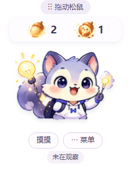
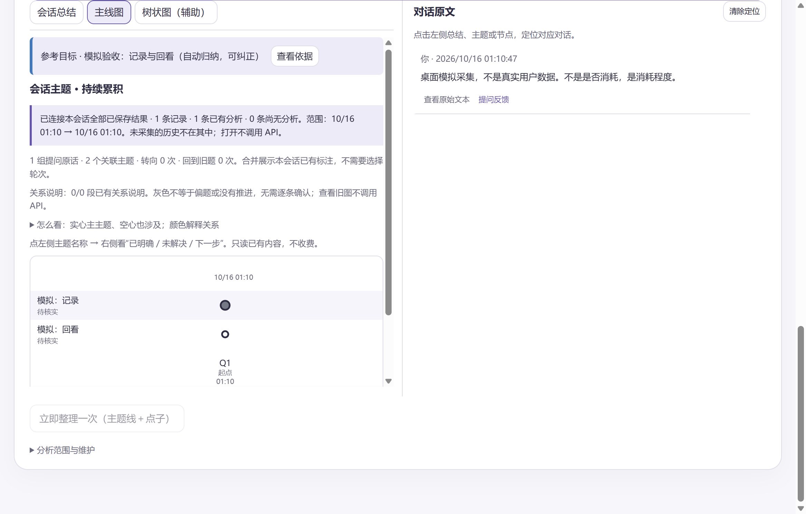
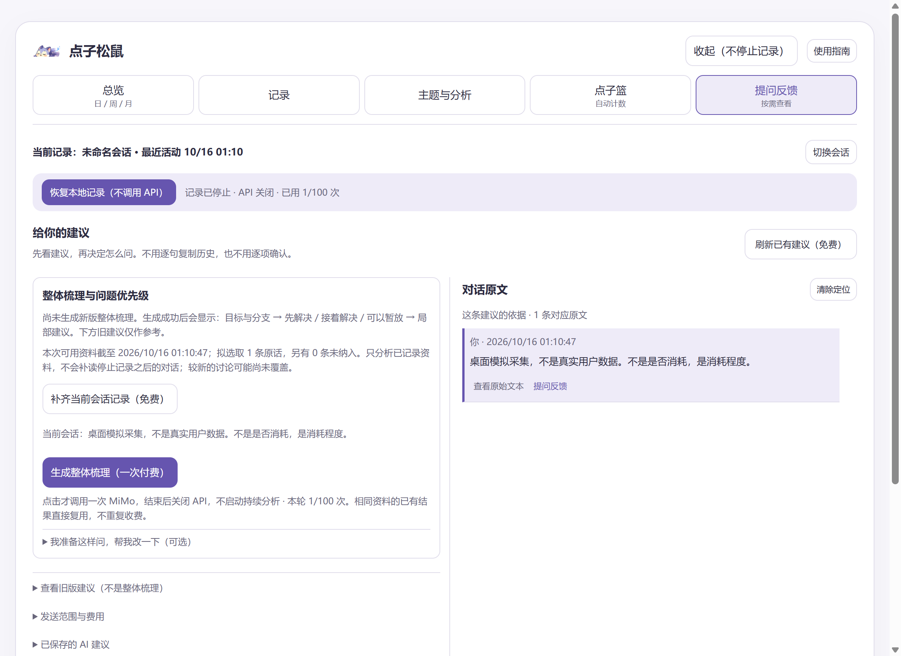

# 点子松鼠桌面版：跟着按钮走

[返回首页](../README.md) · [下载 Windows 便携预览版](https://github.com/zhenyu200308-web/idea-squirrel-codex/releases/tag/desktop-v0.2.0-preview.20261017.012749)

适用 0.2.0／20261017T012749Z（通用 API 版）。本文是桌面软件说明；图片采用虚构测试数据，不要求你的数字相同。

## 1．下载并打开

1. 打开下载页。仓库已公开，查看介绍与下载无需申请仓库权限。
2. 展开 **Assets** → 点击 `idea-squirrel-windows-0.2.0-preview-20261017-012749.zip`，不要点 Source code。
3. 右键 ZIP →「全部解压」→ 选择固定目录，保留整个文件夹。
4. 双击「点子松鼠.exe」。不需要 Node 或网页服务，当前不是 Setup 安装包。

应该看到桌面松鼠和面板，启动时记录与 API 默认关闭。没有历史时没有图正常；系统拦截时核对来源，不要关闭防护。

## 2．认识桌面松鼠

- 鼠标放到松鼠身上：气泡换成果子和数字，不调用 AI。
- 移开：恢复提示。点击松鼠：开面板，不自动开始分析。
- 拖动顶部「拖动松鼠」移动位置；「菜单」或右键松鼠／托盘打开更多操作。

完整果子 = 已收集；破壳果子 = 至少两条原话支撑的展开线索，是已收集的子集，不相加。图中 2／1 为示例。“—”是未提炼或暂未读到数据；0 是已提炼范围内没有计入项。

## 3．选对会话

先在 Codex 打开准备讨论的会话、记住名称，再点松鼠 → 看顶部「当前记录」。

- 名称正确：继续下一步。
- 不正确：点「切换会话」→ 下拉列表按名称选择。选择本身不启动；点「切换到所选会话并自动分析」才开始记录与付费分析，先准备自己的 Key。
- 找不到：在「记录」点「刷新会话列表（免费）」。最近活动不代表前台窗口。

新开 Codex 会话后也需手动切换；旧记录保留，无需寻找或填写 ID。

## 4．配置 Key，开启记录与分析

1. 「主题与分析」→ 展开「模型连接设置」→ 选择「MiMo（原通路）」或「其他兼容 API」。修改前关闭 API 分析并等待请求结束，本地记录可继续。
2. MiMo 首次填写自己的 Key，已配置可留空沿用；其他服务填写 HTTPS 地址、模型 ID、认证方式和该服务自己的 Key →「加密保存配置（免费）」。密钥不回显，保存不调用模型，也不验证有效性。
3. 核对会话后点「开始记录并自动分析」；需要切换则点「切换到所选会话并自动分析」。
4. 回 Codex 发消息，再到松鼠「记录」查看新增原话与计数。

应该看到本地记录进行中。未到门槛时等待，不是每一句都收费；分析时继续记录。

### 其他兼容 API 怎么填

- 地址：服务商的 HTTPS 基础地址（例如 `https://example.com/v1`）或完整 `/chat/completions` 地址。不能填写密钥到 URL 中。
- 模型：服务商提供的模型 ID，不是随意起的显示名称。
- 认证：通常为 Bearer；按服务商文档也可选 api-key。
- 输出长度参数：按服务商选择 `max_tokens` 或 `max_completion_tokens`；JSON 模式仅在服务商支持时勾选。即使关闭 JSON 模式，模型返回的分析也须通过结构与引用校验。
- 更换地址或认证方式必须填写该服务的密钥，不会自动转交原 MiMo Key。
- 想用 MiMo 验证通用入口：选「其他兼容 API」→「填入 MiMo 参数，验证通用通路」→ 主动勾选复用本机 MiMo Key → 保存。预填和保存均免费，之后主动分析才收费。复用仅限官方 MiMo 地址与 api-key 认证。

此入口支持 Chat Completions 兼容格式，不支持原生 Responses、Anthropic Messages 或 Gemini 请求格式。通用通路已用 MiMo 固定测试句验证一次，不代表每家服务商都已测试。返回原 MiMo 只需选择原通路、密钥留空并保存；旧图和用量不会重置。

满 15 条未整理消息（用户＋AI 正式回复，不含进度播报）触发。每批最多 15 条、最多 6 条用户消息，新增摘录最多 12000 字符，长消息会缩小批次。成功后至少间隔两分钟处理积压，末尾不足 15 条也接续处理；清空后重新等待门槛。

想提前处理：点「主题与分析」→「立即整理一次（主题线＋点子）」，这是付费调用。15 条不是保证成功。

## 5．看主题、总结和点子

「主题与分析」→「会话总结／主线图／树状图（辅助）」→ 点主题名称、摘要或节点 → 在右侧核对内容／原话。窄屏可能显示为抽屉。

行是主题，列是用户原话组；实心主要涉及，空心也涉及。换行不等于偏题或进展；灰色尚未判断，不代表不好。上图消息少，仅展示入口和布局。

「点子篮」→「查看清单／查看原话」，有问题再反馈“不对／重复了”。计数不是执行完成数。主题页会话累计与点子篮当前轮次可能范围不同，先看范围说明。

## 6．整体建议＋局部建议

1. 点「提问反馈」，先看资料截止时间和旧结果。「刷新已有建议（免费）」不重新生成。
2. 缺停止期间历史时，先停止记录与 API →「补齐当前会话记录（免费）」。只补选中会话的缺失消息，不重复入库、不调用模型，也不会自动更新旧建议。
3. 确认范围后点「生成整体梳理（一次付费）」。可选展开「我准备这样问，帮我改一下」填写草稿，不用逐句复制历史。
4. 成功后读大目标、分支结论和缺口，再读「先解决／接着解决／可以暂放」。已解决、暂缓和未复核历史事项分开看。
5. 点问题的「查看依据与局部建议」→ 右侧看原话，左侧看下一步、验收方法和可编辑提示词 → 复制后由你决定是否发送给 Codex。

上图是生成入口，不是已成功生成的整体结果。整体建议与主题线自动分析分开，不会每批自动更新；最多选取 32 条已记录摘录并结合摘要，不保证覆盖整场。查看覆盖与遗漏范围；旧模板不等于新版梳理。

## 7．停止与退出

**停止工作：**「停止记录和分析」→ 核对本地记录已停止、API 已关闭；有在途请求时等取消结束。旧图、建议和用量保留。

**彻底退出：**「菜单」／托盘 →「退出程序」。重开默认停止。

**不是停止：**收起、关闭面板、隐藏到托盘只是隐藏窗口。记录进行中但 API 关闭时，只记录，不生成新主题结果。

## 8．常见卡点

| 状态 | 怎么办 |
| --- | --- |
| 「恢复本地记录（不调用 API）」 | 只恢复记录，不会恢复分析。先排查失败，再决定是否付费重试 |
| 分析暂停、旧图还在 | 是上次成功的结果，不是仍在分析。记下错误类别和时间，不连点 |
| 「补齐失败内容并继续分析（可能再次计费）」 | 点击才授权重试，沿用旧图处理未成功内容；成功后继续分批，失败再暂停 |
| 100 次上限 | 不是余额提示。失败也计次，重启不清零；额外单次须明确授权 |
| 新消息没记上 | 核对会话和记录状态。开启前历史不自动补入 |
| 建议还是旧话题 | 核对资料截止时间；必要时先免费补读，再主动生成新建议 |

## 9．费用与数据

不调用模型：看图、看数量、刷新旧建议、保存 Key、补读历史、只恢复本地记录。可能收费：自动批次、立即整理、生成整体建议、重试；已送达服务商的失败或取消请求也可能计费。

记录、密钥和日志在 `%APPDATA%\点子松鼠`，主动分析会将所选素材发给当前配置的模型服务。发行包不携带作者 Key。更新前正常退出，解压到新文件夹，保留数据目录；不要把数据目录或日志直接发到 Issue。

## 10．照着验收

- [ ] 解压启动成功，默认没有自动分析。
- [ ] 悬停显示两种果子，点击能开面板。
- [ ] 会话名称正确，开始后的消息能在「记录」看到。
- [ ] 自己决定是否做一次付费分析，核对至少两处原话依据。
- [ ] 停止后记录与 API 都关闭，在途请求结束后次数不再增加。
- [ ] 退出重开旧图和次数保留，默认不分析。

隔离测试通过不代替真人验收。反馈请附版本、点击步骤、预期、实际结果及脱敏截图。
